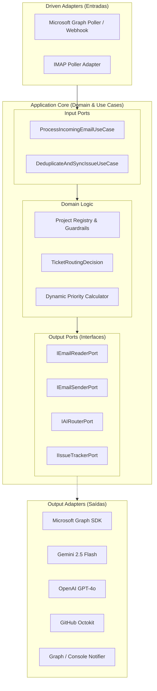
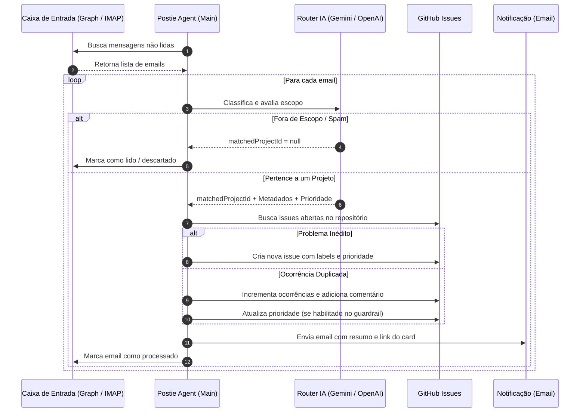

<div align="center">

# 📮 Postie — Ticket Router Agent

**Agente autônomo inteligente de triagem, roteamento e deduplicação de chamados com IA.**

[](https://www.typescriptlang.org/)
[](https://nodejs.org/)
[](#-arquitetura)
[](https://www.docker.com/)
[](LICENSE)

[Visão Geral](#-visão-geral) •
[Funcionalidades](#-funcionalidades) •
[Arquitetura](#-arquitetura) •
[Começando](#-começando) •
[Configuração](#-configuração) •
[Como Funciona](#-como-funciona) •
[Testes](#-testes) •
[Deploy](#-deploy-com-docker)

</div>

---

## 🌟 Visão Geral

O **Postie (Ticket Router Agent)** é um serviço autônomo projetado para monitorar caixas de entrada de email corporativas (Microsoft 365 / Graph API ou IMAP), higienizar as mensagens, analisá-las via Large Language Models (Google Gemini 2.5 Flash ou OpenAI GPT-4o) e rotear os tickets para os repositórios e projetos correspondentes no **GitHub Issues**.

Construído sob os princípios rígidos de **Clean Architecture (Ports & Adapters)**, o Postie assegura que qualquer serviço externo (provedor de email, modelo de IA ou issue tracker) seja 100% intercambiável sem alterar as regras de negócio.

---

## ✨ Funcionalidades

- 🧠 **Triagem & Roteamento Inteligente com IA:** Classifica a intenção (Bug, Feature Request, Dúvida ou Spam), avalia conformidade de escopo e sugere títulos objetivos e descrições estruturadas em Markdown.
- 🛡️ **Catálogo Declarativo com Guardrails Estritos:** Delimita fronteiras de escopo (*Scope Boundaries*) e permissões de ação por projeto (`create_issue`, `update_priority`, `comment`, `auto_close`).
- 🔍 **Deduplicação Semântica de Issues:** Verifica tickets abertos antes de criar novas ocorrências, evitando poluição e redundância no backlog.
- 📈 **Escalonamento Dinâmico de Prioridade:** Ajusta a criticidade do chamado de acordo com a reincidência de relatos de usuários (ex: 3+ relatos elevam para `HIGH`, 5+ para `CRITICAL`).
- 🔌 **Provedores Intercambiáveis:**
  - **Email:** Microsoft Graph API (OAuth2 / App Secret) e IMAP padrão.
  - **IA:** Google Gemini (`@google/genai` com `responseSchema` estrito) e OpenAI.
  - **Issue Tracker:** GitHub Issues via Octokit (extensível para Jira, GitLab, Linear).
- 📧 **Notificações Automáticas:** Envia emails aos mantenedores e equipes responsáveis com link direto para o card criado/atualizado e justificativa da IA.
- 🐳 **Pronto para Produção:** Multi-stage Dockerfile enxuto com execução como usuário não-root.

---

## 🏗️ Arquitetura

O projeto adota **Hexagonal Architecture (Ports & Adapters)**:



### Estrutura de Pastas

```bash
postie/
├── src/
│   ├── config/                      # Configurações e variáveis de ambiente
│   │   ├── env.ts                   # Validação Zod de schema do .env
│   │   └── projects.registry.ts     # Catálogo declarativo e guardrails de projetos
│   ├── domain/                      # Camada de Domínio (independente de libs externas)
│   │   ├── entities/                # Entidades fundamentais
│   │   │   ├── email-message.entity.ts
│   │   │   ├── project-definition.entity.ts
│   │   │   └── routing-decision.entity.ts
│   │   ├── logic/                   # Regras de negócio puras
│   │   │   └── priority-engine.ts   # Motor de escalonamento dinâmico
│   │   └── ports/                   # Contratos de interfaces (Ports)
│   │       ├── email-reader.port.ts
│   │       ├── email-sender.port.ts
│   │       ├── ai-router.port.ts
│   │       └── issue-tracker.port.ts
│   ├── application/                 # Casos de Uso (Orquestração da aplicação)
│   │   └── use-cases/
│   │       ├── process-incoming-email.use-case.ts
│   │       └── deduplicate-and-sync-issue.use-case.ts
│   ├── infrastructure/              # Adaptadores externos (Driven Adapters)
│   │   ├── email/                   # Leitores de Email (MS Graph e IMAP)
│   │   ├── ai/                      # Roteadores de IA (Gemini e OpenAI)
│   │   ├── tracker/                 # Issue Trackers (GitHub Octokit)
│   │   └── notifications/           # Notificadores de Alerta
│   └── main.ts                      # Composition Root e loop de polling
├── tests/                           # Suíte de testes unitários com Vitest
├── docker-compose.yml
├── Dockerfile
├── .dockerignore
├── .env.example
├── tsconfig.json
└── package.json
```

---

## 🚀 Começando

### Pré-requisitos
- [Node.js](https://nodejs.org/) `>= 20.0.0`
- [pnpm](https://pnpm.io/) `>= 9.0.0` (ou npm / yarn)
- Token de Acesso Pessoal (PAT) do GitHub com escopo de `repo`
- Chave de API do Google Gemini ou OpenAI
- Credenciais de Caixa de Entrada (Microsoft 365 Azure AD ou IMAP)

### 1. Clonar o Repositório
```bash
git clone https://github.com/tlsamaral/postie.git
cd postie
```

### 2. Instalar as Dependências
```bash
pnpm install
```

### 3. Configurar as Variáveis de Ambiente
Crie um arquivo `.env` a partir do template:
```bash
cp .env.example .env
```

Edite o `.env` com suas credenciais:
```dotenv
# Configurações Gerais
NODE_ENV=development
LOG_LEVEL=info

# Provedor de Email Ativo: 'MS_GRAPH' ou 'IMAP'
EMAIL_PROVIDER=MS_GRAPH

# Microsoft 365 / Azure AD (Obrigatório se EMAIL_PROVIDER=MS_GRAPH)
AZURE_TENANT_ID=00000000-0000-0000-0000-000000000000
AZURE_CLIENT_ID=00000000-0000-0000-0000-000000000000
AZURE_CLIENT_SECRET=sua_azure_secret_aqui
MS_GRAPH_MAILBOX_USER=suporte@empresa.com

# Provedor de IA: 'GEMINI' ou 'OPENAI'
AI_PROVIDER=GEMINI
GEMINI_API_KEY=AIzaSy...

# GitHub Issue Tracker
GITHUB_AUTH_TOKEN=ghp_...

# Frequência de Polling (segundos) e Email de Notificação
POLLING_INTERVAL_SECONDS=60
ALERT_NOTIFICATION_EMAIL=equipe-dev@empresa.com
```

### 4. Executar em Modo de Desenvolvimento
```bash
pnpm dev
```

---

## ⚙️ Configuração

### 🛡️ Catálogo de Projetos & Guardrails

Os projetos atendidos pelo agente são configurados declarativamente em [`src/config/projects.registry.ts`](src/config/projects.registry.ts).

Cada projeto define:
1. **`scopeBoundaries`**: Instruções determinísticas que orientam a IA sobre o que pertence e o que **NÃO** pertence ao projeto.
2. **`allowedActions`**: Ações operacionais autorizadas para o agente:
   - `'create_issue'`: Criação de novo card quando o problema for inédito.
   - `'update_priority'`: Escalonamento automático de prioridade por volume de ocorrências.
   - `'comment'`: Adição de comentários com novas ocorrências em issues existentes.
   - `'auto_close'`: Fechamento automático de issues.

```typescript
export const PROJECTS_CATALOG: ProjectDefinition[] = [
  {
    id: 'portal-cliente',
    name: 'Portal do Cliente',
    description: 'Área logada onde clientes acompanham pedidos e faturas.',
    scopeBoundaries: [
      'Pertence: login, segunda via de boleto, status de pedido.',
      'Não pertence: dúvidas comerciais, negociação de preço.',
    ],
    github: {
      owner: 'minha-organizacao',
      repo: 'portal-cliente',
    },
    allowedActions: ['create_issue', 'update_priority', 'comment'],
  },
  {
    id: 'erp-integrador',
    name: 'Integrador ERP',
    description: 'Sincronização de pedidos, estoque e financeiro com o ERP.',
    scopeBoundaries: [
      'Pertence: webhooks, conciliação bancária, divergência cadastral.',
    ],
    github: {
      owner: 'minha-organizacao',
      repo: 'erp-sync-service',
    },
    // Limitação de guardrail estrita: apenas cria issues para revisão humana
    allowedActions: ['create_issue'],
  },
]
```

---

## 🔄 Como Funciona



---

## 🧪 Testes

A suíte de testes unitários foi desenvolvida com [Vitest](https://vitest.dev/), cobrindo validação de esquemas de ambiente, cálculo dinâmico de prioridades, isolamento de guardrails e fluxos de deduplicação:

```bash
# Executar todos os testes
pnpm test

# Executar testes em modo watch
pnpm test:watch

# Checagem estática de tipos TypeScript
pnpm typecheck
```

---

## 🐳 Deploy com Docker

### Via Docker Compose
```bash
# Iniciar o serviço em background com rebuild
docker compose up -d --build

# Visualizar logs em tempo real
docker compose logs -f
```

### Build Manual da Imagem
```bash
docker build -t postie-agent:latest .
docker run -d --name postie-agent --env-file .env postie-agent:latest
```

---

## 🛠️ Scripts Disponíveis

| Script | Descrição |
|---|---|
| `pnpm dev` | Executa o agente em modo watch via `tsx` |
| `pnpm build` | Compila o projeto com `tsup` gerando bundle otimizado em `dist/` |
| `pnpm start` | Executa o bundle de produção compilado (`node dist/main.js`) |
| `pnpm typecheck` | Executa a verificação de tipos estritos do TypeScript (`tsc --noEmit`) |
| `pnpm test` | Executa os testes unitários via `vitest run` |
| `pnpm test:watch` | Executa testes de forma reativa durante o desenvolvimento |

---

## 🤝 Contribuindo

Contribuições são muito bem-vindas! Siga os passos abaixo:

1. Faça um Fork do projeto (`https://github.com/tlsamaral/postie/fork`)
2. Crie uma branch para sua funcionalidade (`git checkout -b feature/minha-feature`)
3. Commit suas alterações (`git commit -m 'feat: adiciona novo adaptador Jira'`)
4. Faça o Push para a branch (`git push origin feature/minha-feature`)
5. Abra um Pull Request detalhado

---

## 📄 Licença

Distribuído sob a licença **ISC**. Consulte `LICENSE` para mais detalhes.
