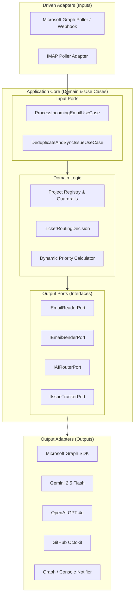
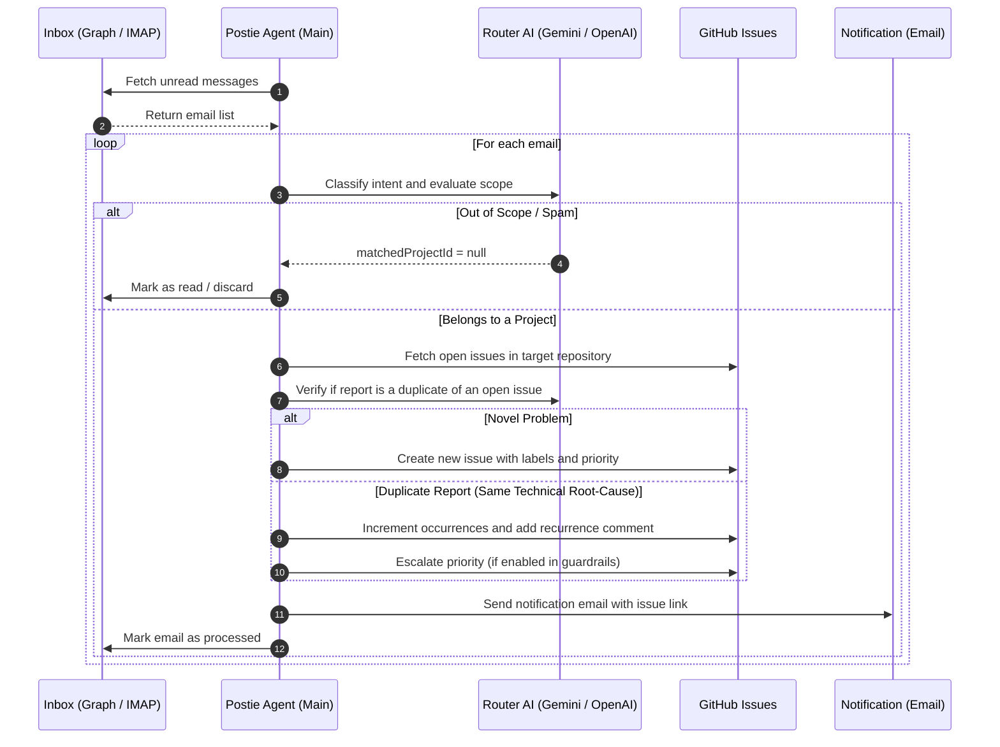

<div align="center">

# 📮 Postie — Ticket Router Agent

**Autonomous intelligent ticket triage, routing, and deduplication agent powered by AI.**

[ 🇺🇸 English ](README.md) • [ 🇧🇷 Português ](README.pt-BR.md)

[](https://www.typescriptlang.org/)
[](https://nodejs.org/)
[](#-architecture)
[](https://www.docker.com/)
[](LICENSE)

[Overview](#-overview) •
[Features](#-features) •
[Architecture](#-architecture) •
[Getting Started](#-getting-started) •
[Configuration](#-configuration) •
[How It Works](#-how-it-works) •
[Testing](#-testing) •
[Deploy](#-docker-deployment)

</div>

---

## 🌟 Overview

**Postie (Ticket Router Agent)** is an autonomous backend service designed to monitor corporate inboxes (Microsoft 365 / Graph API or standard IMAP), sanitize incoming emails, evaluate them via Large Language Models (Google Gemini 2.5 Flash or OpenAI GPT-4o), and route tickets directly to target repositories in **GitHub Issues**.

Built strictly following **Clean Architecture (Hexagonal / Ports & Adapters)** principles, Postie ensures that external services (email providers, AI models, issue trackers) are 100% interchangeable without modifying domain business rules.

---

## ✨ Features

- 🧠 **Intelligent AI Triage & Routing:** Classifies intent (Bug, Feature Request, Question, or Spam), evaluates project scope boundaries, and generates structured issue titles and Markdown descriptions.
- 👁️ **Multimodal Vision & Evidence OCR:** Analyzes error screenshots and attached images via Gemini 2.5 Flash, transcribing visual technical evidence into the issue body.
- 🎯 **Interactive Project Selector:** Terminal wizard (`pnpm select:projects`) to browse user and organization repositories and interactively select which projects should receive tickets.
- 🛡️ **Declarative & Dynamic Catalog with Guardrails:** Defines scope boundaries and allowed actions per project (`create_issue`, `update_priority`, `comment`, `auto_close`). Supports central configuration in `projects.catalog.json` or distributed via `.github/postie.json` in target repositories.
- 🔍 **AI-Verified Semantic Deduplication:** Uses Portuguese/English stemming, domain stopword filtering, and Gemini semantic verification to group reoccurring incidents without merging distinct technical problems.
- 📈 **Dynamic Priority Escalation:** Automatically elevates ticket severity based on incident frequency (e.g., 3+ reports escalate to `HIGH`, 5+ to `CRITICAL`).
- 🔌 **Interchangeable Providers:**
  - **Email:** Microsoft Graph API (OAuth2 / App Secret) and standard IMAP.
  - **AI:** Google Gemini (`@google/genai` with strict `responseSchema`) and OpenAI.
  - **Issue Tracker:** GitHub Issues via Octokit (extensible to Jira, GitLab, Linear).
- 📧 **Automated & Resilient Notifications:** Sends alert emails to maintainers with direct links to the created/updated issue and AI reasoning.
- 🐳 **Production-Ready:** Lean multi-stage Dockerfile running under a secure non-root user.

---

## 🏗️ Architecture

The project follows the **Hexagonal Architecture (Ports & Adapters)** pattern:



### Directory Structure

```bash
postie/
├── src/
│   ├── config/                           # Environment variables and configurations
│   │   ├── env.ts                        # Zod schema validation for .env
│   │   ├── projects.catalog.example.json # Catalog configuration template
│   │   └── projects.registry.ts          # Loader and fallback registry
│   ├── domain/                      # Domain layer (pure business logic)
│   │   ├── entities/                # Core domain entities
│   │   │   ├── email-message.entity.ts
│   │   │   ├── project-definition.entity.ts
│   │   │   └── routing-decision.entity.ts
│   │   ├── logic/                   # Pure business algorithms
│   │   │   └── priority-engine.ts   # Dynamic priority escalation calculator
│   │   └── ports/                   # Port interfaces (Contracts)
│   │       ├── email-reader.port.ts
│   │       ├── email-sender.port.ts
│   │       ├── ai-router.port.ts
│   │       └── issue-tracker.port.ts
│   ├── application/                 # Use cases orchestration
│   │   └── use-cases/
│   │       ├── process-incoming-email.use-case.ts
│   │       └── deduplicate-and-sync-issue.use-case.ts
│   ├── infrastructure/              # External adapters (Driven Adapters)
│   │   ├── email/                   # Email readers (MS Graph and IMAP)
│   │   ├── ai/                      # AI routers (Gemini and OpenAI)
│   │   ├── tracker/                 # Issue trackers (GitHub Octokit)
│   │   └── notifications/           # Alert notifiers
│   └── main.ts                      # Composition root & polling loop
├── scripts/                         # Automation & CLI tools
│   ├── select-projects.ts           # Interactive terminal project picker
│   └── sync-projects.ts             # Topic-based auto-discovery script
├── .github/
│   └── postie.example.json          # Target repository configuration template
├── tests/                           # Unit tests with Vitest
├── docker-compose.yml
├── Dockerfile
├── .dockerignore
├── .env.example
├── tsconfig.json
└── package.json
```

---

## 🚀 Getting Started

### Prerequisites
- [Node.js](https://nodejs.org/) `>= 20.0.0`
- [pnpm](https://pnpm.io/) `>= 9.0.0` (or npm / yarn)
- GitHub Personal Access Token (PAT) with `repo` scope
- Google Gemini API Key or OpenAI API Key
- Email inbox credentials (Microsoft 365 Azure AD or IMAP)

### 1. Clone the Repository
```bash
git clone https://github.com/tlsamaral/postie.git
cd postie
```

### 2. Install Dependencies
```bash
pnpm install
```

### 3. Configure Environment Variables
Copy the template to `.env`:
```bash
cp .env.example .env
```

Edit `.env` with your credentials:
```dotenv
# General Settings
NODE_ENV=development
LOG_LEVEL=info

# Active Email Provider: 'MS_GRAPH' or 'IMAP'
EMAIL_PROVIDER=MS_GRAPH

# Microsoft 365 / Azure AD (Required when EMAIL_PROVIDER=MS_GRAPH)
AZURE_TENANT_ID=00000000-0000-0000-0000-000000000000
AZURE_CLIENT_ID=00000000-0000-0000-0000-000000000000
AZURE_CLIENT_SECRET=your_azure_client_secret_value
MS_GRAPH_MAILBOX_USER=support@company.com

# AI Provider: 'GEMINI' or 'OPENAI'
AI_PROVIDER=GEMINI
GEMINI_API_KEY=AIzaSy...

# GitHub Issue Tracker
GITHUB_AUTH_TOKEN=ghp_...

# Polling Interval (seconds) and Alert Email
POLLING_INTERVAL_SECONDS=60
ALERT_NOTIFICATION_EMAIL=dev-team@company.com
```

### 4. Select Target Projects
Choose which repositories should receive tickets interactively:
```bash
pnpm select:projects
```

### 5. Run in Development Mode
```bash
pnpm dev
```

---

## ⚙️ Configuration

### 🛡️ Project Catalog & Guardrails

Monitored projects are loaded dynamically from [`src/config/projects.catalog.json`](src/config/projects.catalog.json) with fallback to [`src/config/projects.registry.ts`](src/config/projects.registry.ts).

Each project defines:
1. **`scopeBoundaries`**: Deterministic prompt rules instructing the AI on what belongs and what does **NOT** belong to the project.
2. **`allowedActions`**: Operational permissions granted to the agent:
   - `'create_issue'`: Creates new cards for novel issues.
   - `'update_priority'`: Automatically escalates priority as occurrences rise.
   - `'comment'`: Adds recurrence comments to existing issues.
   - `'auto_close'`: Automated issue resolution.

```json
[
  {
    "id": "unisal-siga",
    "name": "unisal.siga",
    "description": "Queue management system, digital signage, and self-service kiosks.",
    "scopeBoundaries": [
      "Belongs: Issues, bugs, questions, and enhancements regarding queue management and kiosk tickets.",
      "Does not belong: Out-of-scope topics, commercial proposals, marketing."
    ],
    "github": {
      "owner": "dev-unisal",
      "repo": "unisal.siga"
    },
    "allowedActions": [
      "create_issue",
      "update_priority",
      "comment"
    ]
  }
]
```

---

## 🔄 How It Works



---

## 🧪 Testing

Unit test suite developed with [Vitest](https://vitest.dev/), covering environment validation, dynamic priority calculation, guardrail boundaries, and semantic deduplication:

```bash
# Run all tests
pnpm test

# Run tests in watch mode
pnpm test:watch

# Static TypeScript typecheck
pnpm typecheck
```

---

## 🐳 Docker Deployment

### Via Docker Compose
```bash
# Start background service with rebuild
docker compose up -d --build

# Follow logs in real-time
docker compose logs -f
```

### Manual Container Build
```bash
docker build -t postie-agent:latest .
docker run -d --name postie-agent --env-file .env postie-agent:latest
```

---

## 🛠️ Available Scripts

| Script | Description |
|---|---|
| `pnpm dev` | Runs the agent in watch mode via `tsx` |
| `pnpm select:projects` | Interactive terminal wizard to browse and pick repositories for the catalog |
| `pnpm sync:projects` | Synchronizes GitHub repositories automatically based on the `postie-target` topic |
| `pnpm build` | Bundles the project with `tsup` into optimized ESM in `dist/` |
| `pnpm start` | Executes the compiled production bundle (`node dist/main.js`) |
| `pnpm typecheck` | Runs strict TypeScript type-checking (`tsc --noEmit`) |
| `pnpm test` | Runs the Vitest test suite (`vitest run`) |
| `pnpm test:watch` | Runs tests reactively during development |

---

## 🤝 Contributing

Contributions are welcome! Follow these steps:

1. Fork the project (`https://github.com/tlsamaral/postie/fork`)
2. Create a feature branch (`git checkout -b feature/my-feature`)
3. Commit your changes (`git commit -m 'feat: add new feature'`)
4. Push to the branch (`git push origin feature/my-feature`)
5. Open a detailed Pull Request

---

## 📄 License

Distributed under the **ISC** License. See `LICENSE` for details.
